<!-- header:start -->
<div align="center">

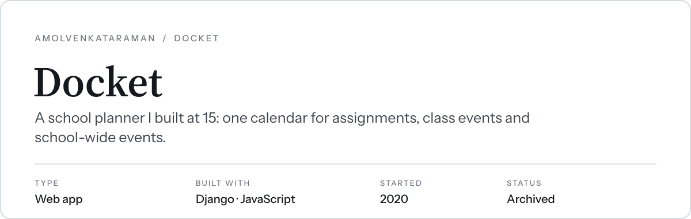


[](LICENSE)

[Features](#features) · [Screenshots](#screenshots) · [Running it locally](#running-it-locally) · [History](#history)

</div>

<a href="https://haiscale.amolven.com/">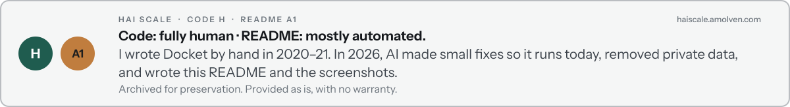</a>
<!-- header:end -->

> [!IMPORTANT]
> **This repository is archived for preservation.** Docket is a 2020–21 project, kept to show that it existed. It isn't maintained and isn't meant for real use or deployment. Its dependencies are old and may have known security vulnerabilities. Use it only to look around, or to run it locally with fake data.

Docket is a school planner web app built with Django. It puts a student's assignments, class events and school-wide events on one calendar, and builds their timetable from the classes they are enrolled in. Teachers create classes, post assignments and events, and hand out invite codes so students can join.

I built it in 2020–2021, at about 15, when my school board moved to online learning and assignments were spread across Google Classroom, Brightspace, Zoom and Google Meet. It ran as a public demo on Heroku.

The screenshots below were taken in 2026 with made-up demo data (fake students, teachers, classes and a synthetic floor plan).

## Features

- **Calendar.** A month view of assignments, class events and school-wide events. Each class has its own colour, and you can show or hide classes from the sidebar.
- **Day-cycle timetable.** Schools that run a rotating "Day 1–4" schedule mark each school day with a `DAY n` event, usually imported from the school's Google Calendar. Docket uses those events to work out which classes fall on each date. Clicking a date shows that day's periods and events, and the full timetable can be printed.
- **Classes and invites.** Teachers create classes, pick the periods each class meets in, and generate invite codes. Students enroll by entering a code.
- **Teacher tools.** Teachers can add assignments (with deadline, priority, graded flag and a link), single-class events and school-wide events, including holidays, straight from any calendar day.
- **School map.** Floor plans shown with Leaflet. Click a room to see its name, floor and type. Superusers can add rooms by clicking their corners on the map.
- **Google Calendar import.** A superuser-only endpoint, `/calendar/add_from_gc/?start=...&end=...`, pulls events from a public Google Calendar into school-wide events. It needs `GOOGLE_API_KEY` and `GOOGLE_CALENDAR_ID`.
- **Smaller pieces.** A home page with a large clock, profile pictures (set in the admin), an onboarding pop-up, a warning for old or unsupported browsers, and a small stats page for superusers at `/calendar/stats/`. The stats app also records each logged-in user's browser and device details once.

Some parts were never finished:

- **Chat.** Only the page exists. Its JavaScript expects a Socket.IO server that isn't in this repo, so you can't send messages.
- **Video chat.** The `videochat` app is an empty stub, and its URL is commented out.
- **Settings.** The settings page is mostly placeholders.

## Screenshots

| | |
|---|---|
| 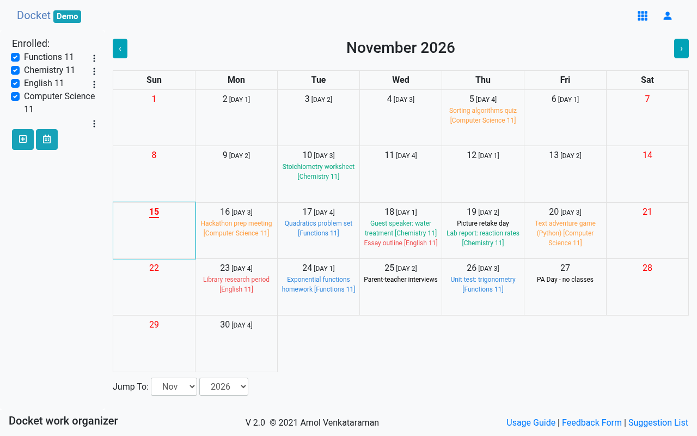 Month calendar (student) | 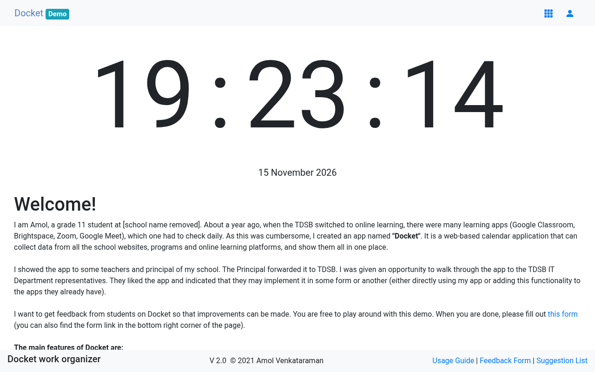 Home page |
| 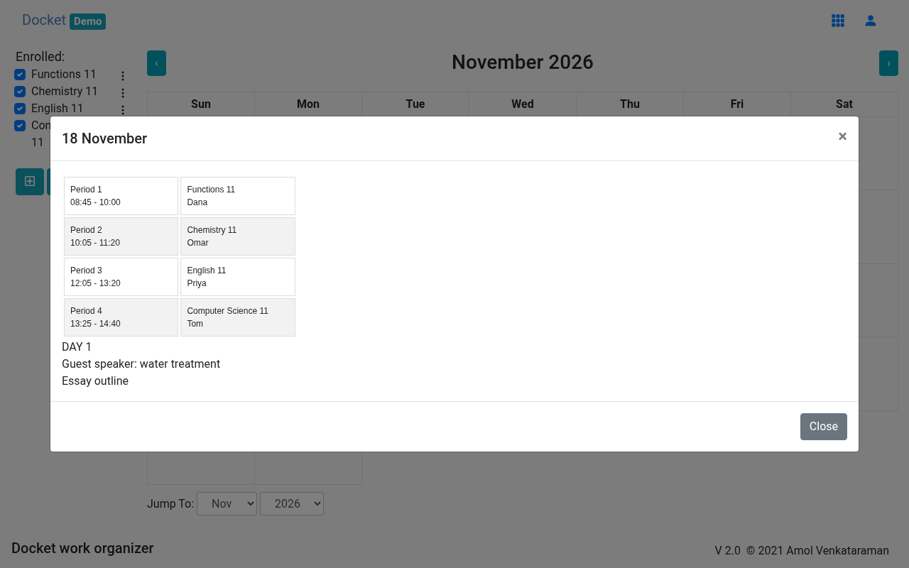 Day view: periods and events for one date | 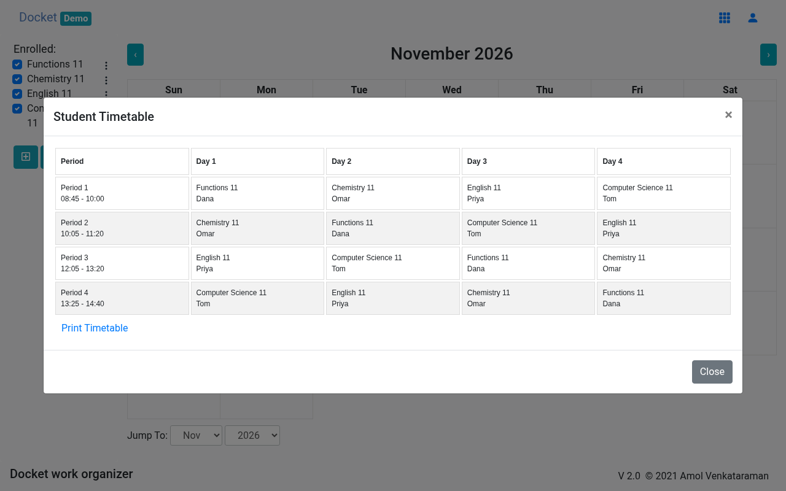 Generated 4-day timetable |
| 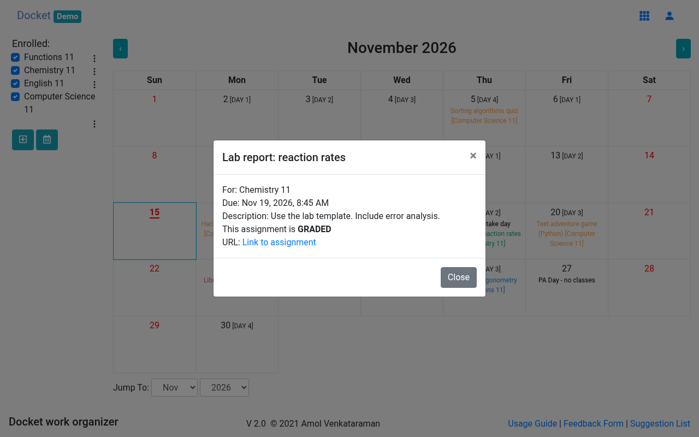 Assignment details | 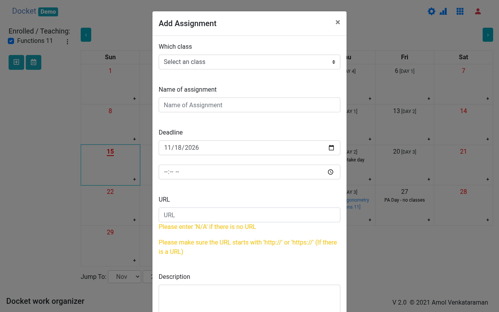 Teacher adding an assignment |
| 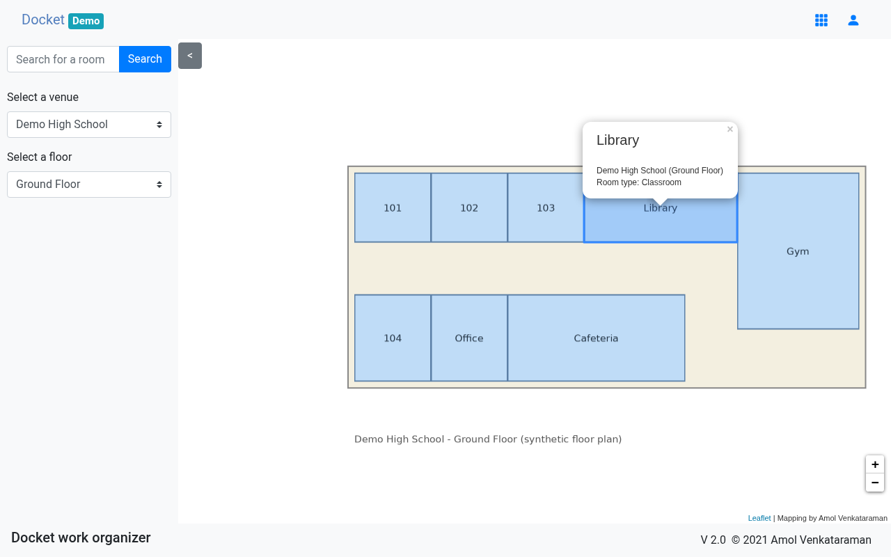 School map with a selected room | 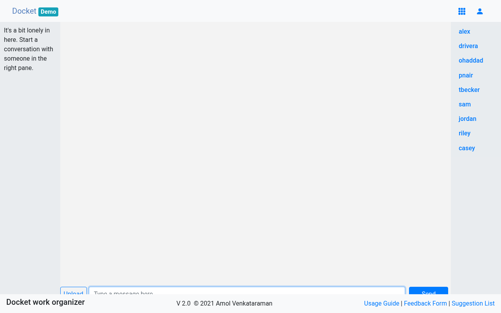 Chat page (front end only) |
| 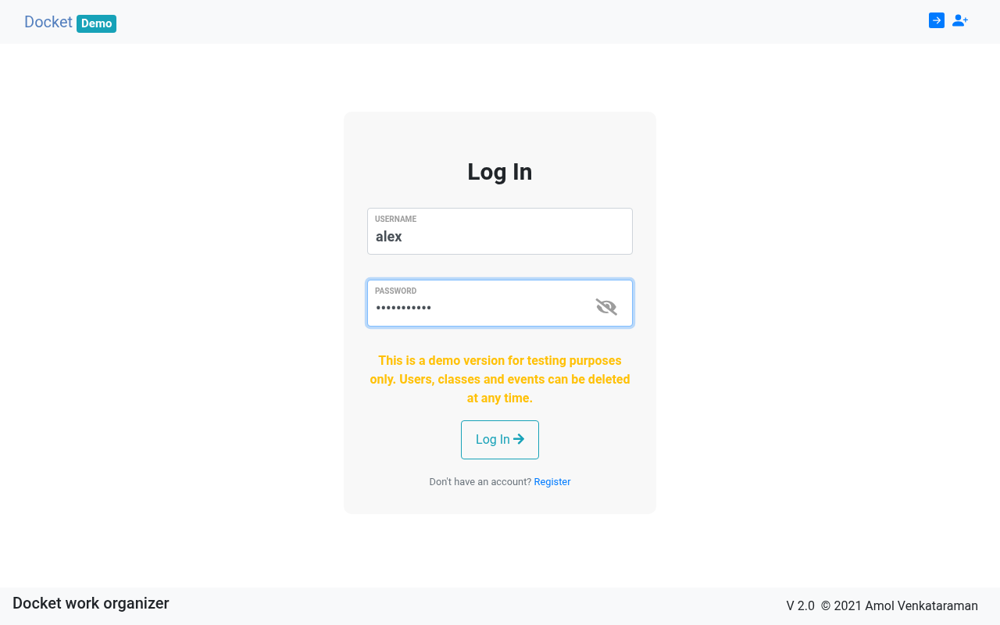 Login | |

## Tech stack

- Python 3.9 (`runtime.txt` says 3.9.5)
- Django 3. It was developed on 3.0.2 and later 3.1.4, and is pinned to 3.2.25 as of 2026.
- django-crispy-forms (Bootstrap 4 template pack) for the login and register forms
- WhiteNoise for static files, and Gunicorn plus django-heroku for the Heroku deployment
- SQLite
- Front end: plain JavaScript and Django templates, with these libraries loaded from CDNs:
  - Bootstrap 4
  - jQuery 3.3.1 (slim)
  - Popper.js 1.14.3
  - Handlebars
  - Leaflet 1.6.0
  - UAParser.js
  - Font Awesome

The repo contains no vendored third-party code.

## Running it locally

You need [uv](https://docs.astral.sh/uv/), or any Python 3.9 with pip.

```sh
uv venv -p 3.9 .venv
source .venv/bin/activate
uv pip install -r requirements.txt

export DJANGO_DEBUG=1          # lets runserver serve the static files
python manage.py migrate
python manage.py runserver
```

Open http://127.0.0.1:8000/register/, create an account, and log in.

`createsuperuser` doesn't work, because the user model needs a `grade` value that the command never asks for. To make the account you registered a teacher and superuser, run:

```sh
python manage.py shell -c "from users.models import DocketUser as U; U.objects.filter(username='YOUR_USERNAME').update(teacher=True, is_staff=True, is_superuser=True)"
```

The timetable stays empty until you add days, slots and periods in `/admin/`, along with `DAY n` school-wide events. The map needs a venue, floors and a floor plan image in the same way.

### Environment variables

All of these are optional for local use. See `.env.example`.

| Variable | Default | Used for |
|---|---|---|
| `DJANGO_SECRET_KEY` | an insecure dev key | Django `SECRET_KEY` |
| `DJANGO_DEBUG` | `0` | set to `1` for local development |
| `DJANGO_ALLOWED_HOSTS` | `localhost,127.0.0.1` | comma-separated host names |
| `GOOGLE_API_KEY` | empty | Google Calendar import |
| `GOOGLE_CALENDAR_ID` | empty | Google Calendar import |

Django doesn't read `.env` on its own. Export the variables in your shell, for example with `set -a; source .env; set +a`.

## History

- **2020–2021:** I wrote Docket at about age 15. It started as a simple calendar in May 2020. Classes, invites, timetables and the map followed in the second half of 2020, and the Heroku demo went up in June 2021. In October 2021 I replaced the demo with a shutdown notice.
- **Deployment:** it ran on Heroku (Gunicorn, django-heroku, WhiteNoise).
- **What came next:** Docket is where [Nilaya](https://github.com/amolvenkataraman/Nilaya) began. In early 2021 I carried Docket's calendar into a new project, Comptech, which grew into Nilaya, my self-hosted family life platform.
- **History:** the commit history here comes from the original repository, with the original author and commit dates.
- **2026 cleanup:** before publishing, I scrubbed the history with `git filter-repo`:
  - Removed the database files and data dumps, which held real user accounts, along with uploaded profile pictures, school floor plans, `collectstatic` output and compiled `.pyc` files.
  - Replaced the Django secret key, a Google API key and a school calendar ID with placeholders in every commit, and replaced the school's name with "a Toronto high school".
- **2026 additions:** the README, screenshots, license, `.gitignore` and a few small fixes so it runs again. These are separate, newer commits on top of the original history.

## License

MIT. See [LICENSE](LICENSE).
